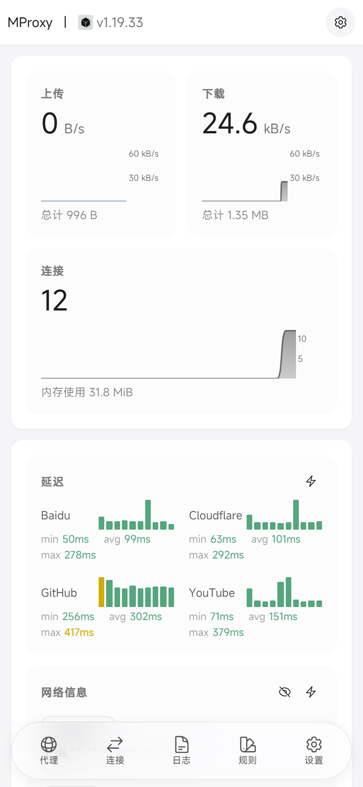
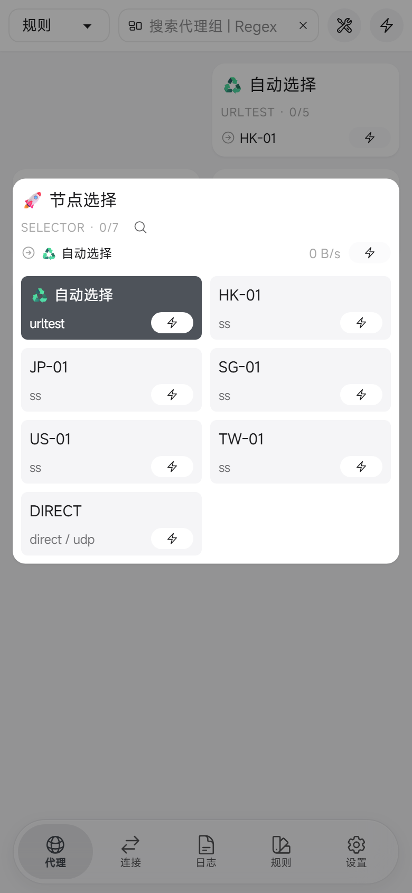
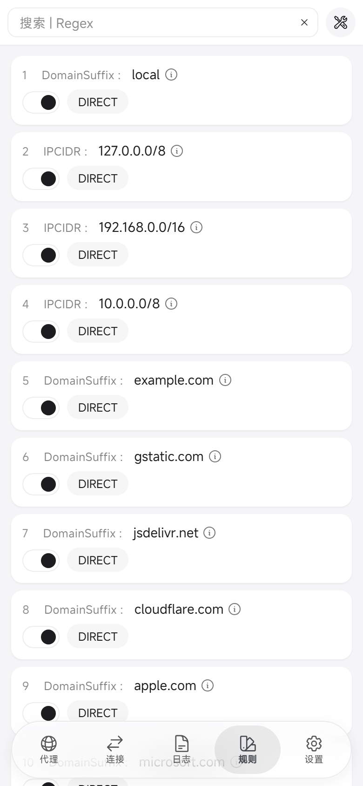
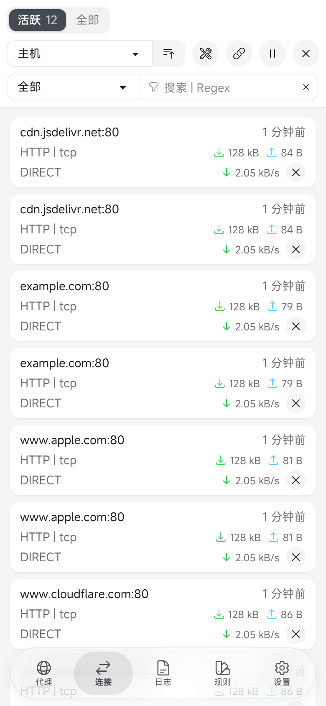
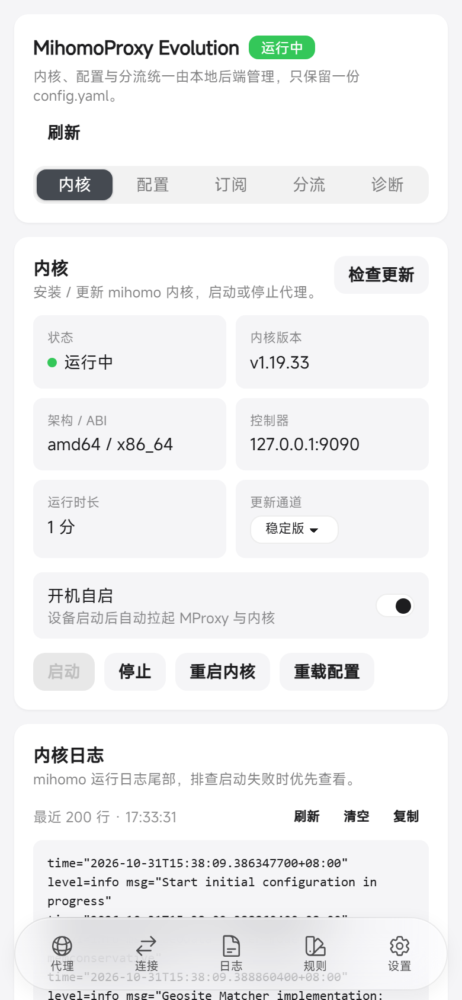
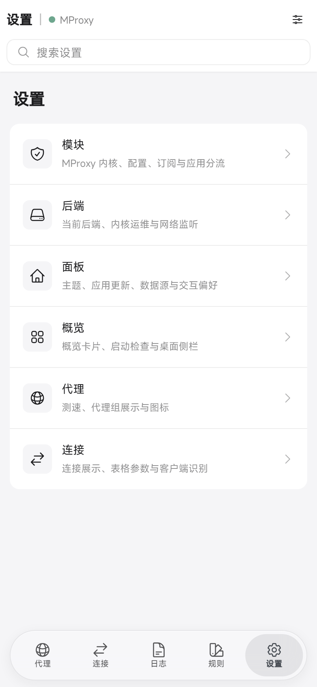

<div align="center">

# MihomoProxy Evolution

**面向 KernelSU / Magisk 的网络代理模块：mihomo 内核 + zashboard 面板，全部在 WebUI 完成，只维护一份配置**

[](https://github.com/f1owkang/MProxyEvolution/releases)
[](#安装)
[](https://go.dev)
[](https://nodejs.org)
[](LICENSE)

[English](README_EN.md) | 简体中文

[特性](#特性) ｜ [界面预览](#界面预览) ｜ [安装](#安装) ｜ [工作原理](#工作原理) ｜ [常见问题](#常见问题) ｜ [兼容性](#兼容性) ｜ [已知限制](#已知限制) ｜ [从源码构建](#从源码构建) ｜ [上游同步](#上游同步) ｜ [免责声明](#免责声明) ｜ [License](#license)

</div>

---

## 特性

- **只维护一份配置**：`/data/adb/mproxy/config.yaml` 既是 mihomo 的标准配置，也是模块设置的唯一来源（`x-mproxy:` 段，mihomo 会忽略）。面板里的端口、模式、TUN、分流改动由后端写回同一文件，重启后仍然生效。
- **全部在 WebUI 完成**：复用 zashboard 的概览、节点、规则、连接、日志页面，并在「设置 → 模块」补齐内核安装 / 更新、启停、配置编辑与校验、订阅导入、应用分流、开机自启与诊断。
- **同源访问，无跨域**：Go 后端内嵌面板静态资源并只监听 `127.0.0.1:9091`；`/api/mihomo/*` 反向代理 mihomo controller（含 HTTP / SSE / WebSocket），面板无需直连内核端口，也不存在混合内容问题。
- **TUN 透明代理**：默认开启 TUN + fake-ip DNS，支持按应用白名单 / 黑名单分流；规则、DNS、端口与订阅仍可自由修改。
- **配置写入安全**：内核已安装时，保存前执行 `mihomo -t` 校验；先写临时文件再原子替换，并保留单份备份 `config.yaml.bak`，校验失败不会覆盖旧配置。
- **四架构开箱即用**：arm64-v8a / armeabi-v7a / x86 / x86_64；模块 zip 内置四套后端与内核，安装器只保留当前设备架构。
- **可复现的上游**：mihomo 以 git submodule 固定到 release tag；zashboard 采用 fork + `panel` 分支，`panel.lock` 固定构建 commit，CI 每日检查上游版本并发起同步 PR。

## 界面预览

WebUI 一览（概览 / 节点 / 规则 / 连接 / MihomoProxy Evolution 模块 / 设置）。截图中的节点、流量、规则与日志均为**虚构的演示数据**，仅用于展示界面效果，不代表真实设备、真实网络或实测结果。

<div align="center">

| 概览 | 节点 | 规则 |
| :---: | :---: | :---: |
| <a href=".github/images/overview-zh.png"></a> | <a href=".github/images/proxies-zh.png"></a> | <a href=".github/images/rules-zh.png"></a> |

| 连接 | MihomoProxy Evolution 模块 | 设置 |
| :---: | :---: | :---: |
| <a href=".github/images/connections-zh.png"></a> | <a href=".github/images/mproxy-zh.png"></a> | <a href=".github/images/settings-zh.png"></a> |

</div>

## 安装

需要 **KernelSU / KernelSU Next（推荐）或 Magisk 26+**，Android 8.0 及以上，支持 arm64-v8a / armeabi-v7a / x86 / x86_64。从 [Releases](https://github.com/f1owkang/MProxyEvolution/releases) 下载模块包，校验后刷入。每个版本提供 **universal**（四架构，应用内自动更新使用）与 4 个**单架构包**：

| 资产 | 说明 |
| :-- | :-- |
| `MProxyEvolution-<versionCode>-<version>.zip` | **universal** 包：含四架构后端与 mihomo 内核（arm64-v8a / armeabi-v7a / x86 / x86_64），应用内自动更新与不确定 ABI 时使用；约 130 MB |
| `MProxyEvolution-<versionCode>-<version>-arm64-v8a.zip` | 单架构包：arm64-v8a（绝大多数手机） |
| `MProxyEvolution-<versionCode>-<version>-armeabi-v7a.zip` | 单架构包：armeabi-v7a（旧款 32 位 ARM 手机） |
| `MProxyEvolution-<versionCode>-<version>-x86.zip` | 单架构包：x86（模拟器 / 电视盒） |
| `MProxyEvolution-<versionCode>-<version>-x86_64.zip` | 单架构包：x86_64（模拟器 / 电视盒） |

每个 zip 都有同名 `.sha256`。单架构包只含对应 ABI 的后端与内核，约 20-35 MB，适合按设备架构下载。

> 选择方式：用 `getprop ro.product.cpu.abi` 查看设备 ABI，下载匹配后缀的单架构包（手机推荐，体积更小）。arm64-v8a / armeabi-v7a 手机用对应架构包；x86 / x86_64（模拟器、电视盒）同样按 ABI 选择，或使用 universal。误装不匹配的单架构包时，安装器会提示下载正确架构或 universal 包。应用内自动更新始终使用 universal。

```bash
# 查看设备 ABI（root 终端；也可用 adb shell 执行）
getprop ro.product.cpu.abi

# 校验（按实际下载的包选择一行）
sha256sum -c MProxyEvolution-1-0.1.0.zip.sha256
sha256sum -c MProxyEvolution-1-0.1.0-arm64-v8a.zip.sha256
sha256sum -c MProxyEvolution-1-0.1.0-armeabi-v7a.zip.sha256
sha256sum -c MProxyEvolution-1-0.1.0-x86.zip.sha256
sha256sum -c MProxyEvolution-1-0.1.0-x86_64.zip.sha256
```

1. KernelSU / KernelSU Next：在管理器中「模块 → 安装」选择 zip，安装完成后**重启设备**，再点击模块的「打开」按钮进入控制台。
2. Magisk：安装 zip 并重启后，用 root 终端执行 `su -c /data/adb/mproxy/bin/mproxy boot`，打开输出的带 token 地址（Magisk 没有内置 WebUI 入口）。
3. 首次进入会按引导安装 / 更新内核、导入节点或订阅；升级模块时已有的 `config.yaml` 与订阅不会被覆盖。
4. 安装器会提示用音量键选择语言并确认安装；30 秒未按键会自动继续安装，音量- 可取消。无人值守/脚本安装可设置 `MPROXY_HEADLESS=1` 跳过按键流程（如 `MPROXY_HEADLESS=1 ksud module install <zip>`）。

安装细节、卸载与排错见下方[常见问题](#常见问题)。

## 工作原理

mihomo 负责代理，zashboard 负责界面，Go 后端把两者串成一个只监听本机的同源服务：

```text
KernelSU / Magisk WebView
  └─ module/webroot/index.html（bootstrap）
      └─ mproxy boot → http://127.0.0.1:9091/?token=...#/settings?section=moduleSettings
          └─ Go 后端（127.0.0.1:9091，内嵌 zashboard）
              ├─ /api/mihomo/*   同源反代 mihomo controller（HTTP / SSE / WS）
              ├─ /api/config     唯一 config.yaml 的读取 / 校验 / 导入
              ├─ /api/core/*     内核安装、启停、更新
              └─ /api/mproxy/*   MProxyEvolution 页面的结构化接口
                  └─ mihomo -d /data/adb/mproxy -f config.yaml
```

- **唯一配置**：后端在 `config.yaml` 缺失时生成默认模板（随机 `secret`、TUN 开启、fake-ip DNS、私有网段直连、`MATCH,PROXY`）。面板设置经 `PATCH /api/mihomo/configs` 先合并进 YAML 再转发，内核重启后设置不丢。
- **同源代理**：面板启动前由 `mproxy-boot.js` 注入 API 基址 `/api/mihomo` 与 token；后端转发时补上 mihomo 的 `Authorization: Bearer`，并拦截 `PATCH/PUT /configs` 与 `restart` 做持久化。
- **仅本机监听**：后端固定 `127.0.0.1:9091`，`/api/*` 需要随机 token（`state/token`，权限 0600）；mihomo controller 默认 `127.0.0.1:9090`，默认不对局域网开放。
- **四架构打包**：mihomo 以 `CGO_ENABLED=0 GOOS=linux` + `with_gvisor` 构建为静态二进制（arm64 / armv7 / 386 / amd64）；`customize.sh` 按 `ro.product.cpu.abi` 只保留当前架构，`post-fs-data.sh` 准备 `/dev/net/tun`，`service.sh` 等 `sys.boot_completed` 后拉起后端。

## 常见问题

<details>
<summary>打开 WebUI 一直停在「正在启动」？</summary>

先确认 `/data/adb/mproxy/bin/mproxy` 存在且可执行，再执行 `/data/adb/mproxy/bin/mproxy boot` 查看输出；同时确认 9091 端口未被占用。日志在 `/data/adb/mproxy/logs/`（`backend.log` / `core.log` / `service.log`）。
</details>

<details>
<summary>第一次打开没有节点、无法上网？</summary>

默认配置是直连模式。进入 MihomoProxy Evolution → 订阅导入 Clash 订阅（URL、文件或粘贴完整配置，支持合并 / 替换），保存后到「内核」确认已启动，再到「节点」选择节点。
</details>

<details>
<summary>如何更新内核、面板和模块？</summary>

内核：MihomoProxy Evolution → 内核 → 检查更新（stable / alpha，国内网络可配置 `x-mproxy.ghproxy` 镜像）。面板与模块：下载新版本 zip 直接刷入，`config.yaml` 与订阅会保留。
</details>

<details>
<summary>升级会丢配置吗？卸载会删数据吗？</summary>

不会。安装器检测到已有 `/data/adb/mproxy/config.yaml` 时绝不覆盖；卸载只停进程并删除模块目录，数据目录 `/data/adb/mproxy` 默认保留，需要彻底清理时可手动删除。
</details>

<details>
<summary>支持哪些设备和架构？</summary>

Android 8.0+，KernelSU / KernelSU Next / Magisk 26+，arm64-v8a / armeabi-v7a / x86 / x86_64。TUN 模式需要内核支持 `/dev/net/tun`（部分原厂内核不支持）。
</details>

## 兼容性

| 环境 | 状态 | 说明 |
| :-- | :-- | :-- |
| KernelSU / KernelSU Next | ✅ 支持（推荐） | 管理器内置 WebUI 入口，安装并重启后点「打开」即可 |
| Magisk 26+ | ✅ 支持 | 无内置 WebUI，重启用 root 终端执行 `su -c /data/adb/mproxy/bin/mproxy boot` |
| APatch | ⚠️ 尽力支持（best-effort） | 兼容 Magisk 模块格式，安装器会检测 `/data/adb/apd` 并在输出中提示；未纳入 CI 与真机回归 |
| Android 8.0+，arm64-v8a / armeabi-v7a / x86 / x86_64 | ✅ 支持 | 需要内核支持 `/dev/net/tun`（部分原厂内核裁剪） |

- 模块必须由 **Magisk / KernelSU / KernelSU Next / APatch 管理器**（或等价的模块安装器入口）安装；安装器检测到 `BOOTMODE=false/0` 时会拒绝继续，避免在非模块环境写坏目录。
- 脚本化安装（如 `ksud module install`）可设置 `MPROXY_HEADLESS=1` 跳过音量键选择并自动安装。
- APatch 属于尽力支持：脚本按 Magisk 模块格式运行，但尚未做完整真机回归；反馈问题时请附面板「设置 → 诊断」导出内容与 `/data/adb/mproxy/logs/` 日志。

## 已知限制

- **仅支持 TUN 模式**：`proxy-mode` 只接受 `tun` 与 `mixed`，v0.1 不提供 tproxy / redirect；透明代理统一走 TUN。
- **热点 / USB 共享等下游设备不保证**：TUN 由 mihomo `auto-route` 负责本机流量，共享给其它设备的流量是否被代理取决于 ROM 与网络栈，当前不做保证。
- **Private DNS（DoT）**：TUN 运行期间模块会保存并自动关闭系统 Private DNS（`private_dns_mode`），停止时恢复原值（异常退出后后端尽力恢复），避免 DoT 绕过 fake-ip DNS 导致解析异常。默认策略为 `x-mproxy.private-dns: auto`；如需保持系统 Private DNS 不变，可在面板「内核 → Private DNS」选择「保持系统设置」（写入 `keep`）。若设备被强制重启导致未恢复，可在系统「网络和互联网 → 私人 DNS」中手动改回。
- **其它 VPN 并存**：与其它 VPN（包括系统自带 VPN）同时开启可能互相抢占路由，建议只保留一个；双卡、电视盒与热点共享需要真机验证。
- **管理器冻结 / 省电策略**：内核进程会脱离管理器 cgroup 运行，管理器切后台或被回收不会中断代理；部分 ROM 的激进省电/后台冻结仍可能杀掉进程，建议为管理器与 MihomoProxy Evolution 关闭电池优化。排查时用 `mproxy status` 与 `/data/adb/mproxy/logs/`。
- **日志位置**：`/data/adb/mproxy/logs/`（`backend.log`、`core.log`、`service.log`），面板「设置 → 诊断」可导出脱敏信息；`service.log` 超过 1 MiB 自动截断并保留最后 2000 行。
- **包体积与 KernelSU Modules**：universal（四架构）zip 约 130 MB，超过 KernelSU Modules 的 100 MB 收录上限，因此只通过 GitHub Releases 分发（也是应用内自动更新的目标）；4 个单架构包（arm64-v8a / armeabi-v7a / x86 / x86_64，各约 20-35 MB）均低于 100 MB，提交 KernelSU Modules 时使用 **arm64-v8a** 单架构包（覆盖绝大多数手机）。

## 从源码构建

需要 Git、Go 1.26+、Node.js 22+、pnpm 11+、`zip` 与 `sha256sum`。

```bash
# 1. 拉取固定版本的上游源码
git submodule update --init --recursive

# 2. 构建：面板 → Go 后端（4 架构）→ mihomo 内核（4 架构）→ 打包
bash scripts/build.sh

# Windows（PowerShell 7）
pwsh -File scripts/build.ps1

# 产物：dist/MProxyEvolution-1-0.1.0.zip 与 .sha256
```

| 目的 | `build.sh` | `build.ps1` |
| --- | --- | --- |
| 指定版本 | `--version 0.2.0` | `-Version 0.2.0` |
| 跳过面板构建 | `--skip-panel` | `-SkipPanel` |
| 跳过后端编译 | `--skip-backend` | `-SkipBackend` |
| 跳过内核编译 | `--skip-core` | `-SkipCore` |
| 只组装不打包 | `--skip-zip` | `-SkipZip` |
| 构建前清理 | `--clean` | `-Clean` |

面板开发时不需要每次都完整打包：

```bash
# 检出 panel.lock 固定的 zashboard fork commit 到 build/panel
bash scripts/dev-panel.sh --prepare

# 检出 + 安装依赖 + 构建面板（产物 build/panel/web/dist）
bash scripts/dev-panel.sh --all

# Windows 对应 scripts/dev-panel.ps1（-Prepare / -Install / -Build / -All）

# 本地跑后端（MPROXY_DEV=1 关闭 /api 鉴权，数据目录默认 ./.dev-data）
cd backend && MPROXY_DEV=1 go run ./cmd/mproxy serve
```

## 上游同步

面板采用 **fork + git merge**：zashboard 上游完整历史在 `panel` 分支上，MProxyEvolution 改动是该分支的普通 commit；`panel.lock` 固定构建使用的 commit，`scripts/dev-panel.sh` 直接检出该 commit 到 `build/panel`。构建不再读取 overlay，也不应用文本 patch。

`upstream/mihomo` 以 git submodule 固定到 release tag，禁止跟随分支 HEAD。`.github/workflows/sync-upstream.yml` 每天检查两个上游的最新 release：mihomo 更新 submodule；zashboard 把 release tag merge 进 `panel` 分支，并创建只更新 `panel.lock` 与 mihomo submodule 的 `chore/sync-panel-<tag>` PR。该 PR 由 workflow token 创建，不会自动触发 CI，合并前需本地或手动触发验证。推送 `v*` tag 时 `release.yml` 构建 `dist/MProxyEvolution-<versionCode>-<version>.zip` 与 `.sha256` 并创建 GitHub Release。

同步失败时工作流直接失败，需要人工处理；发版流程以 `.github/workflows/release.yml` 为准。

## 免责声明

- 刷入本模块会修改系统的模块目录与网络配置，**可能影响开机与联网**；请先确认自己了解 KernelSU / Magisk 的刷入、回退与救砖方式，风险自负。
- 本项目只提供代理能力，**不提供任何节点、订阅或代理服务**。使用代理须遵守所在地法律法规、网络服务条款与运营商规定，因使用产生的后果由使用者自行承担。
- 面板与内核只监听本机回环地址；配置、日志、订阅与 token 保存在 `/data/adb/mproxy`，不会上传到任何服务器。
- 软件按「原样」提供，不附带任何明示或暗示的担保。

## License

本项目以 [GPL-3.0](LICENSE) 发布。面板来自 [zashboard](https://github.com/Zephyruso/zashboard)（MIT），内核来自 [mihomo](https://github.com/MetaCubeX/mihomo)（GPL-3.0）；完整的第三方版权与许可证信息见 [THIRD_PARTY_NOTICES.txt](THIRD_PARTY_NOTICES.txt)。分发包含 mihomo 二进制的模块包时，对应源码由 `upstream/mihomo` submodule 与构建脚本提供。

---

<div align="center">

**Made with ❤ by [f1owkang](https://github.com/f1owkang)**

</div>