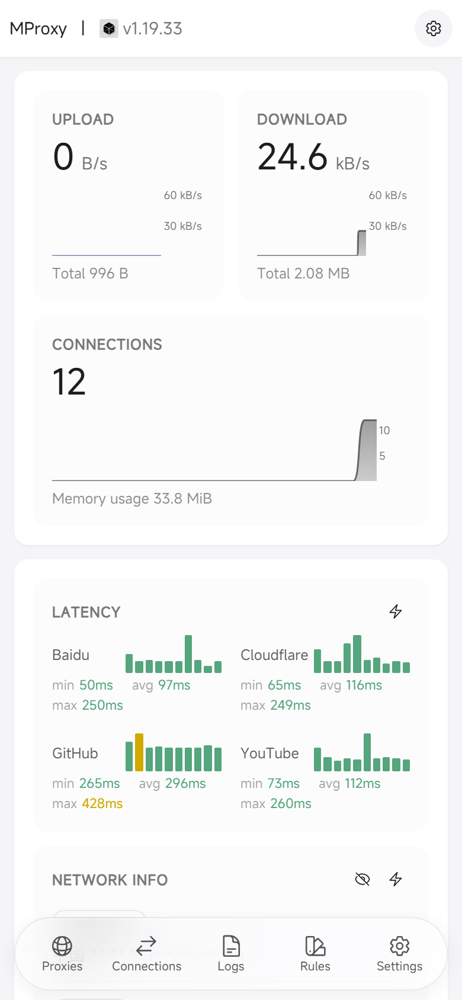
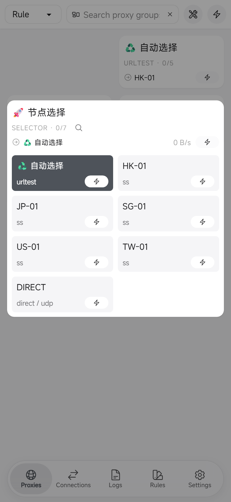
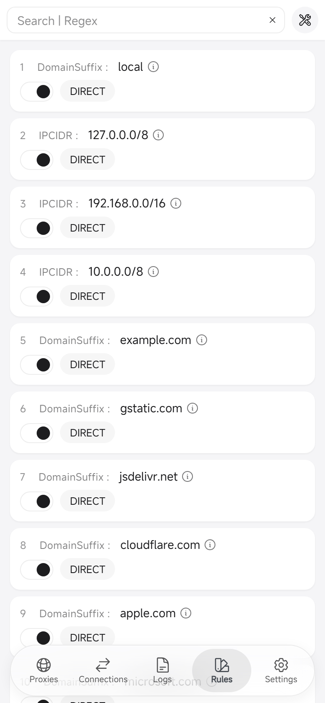
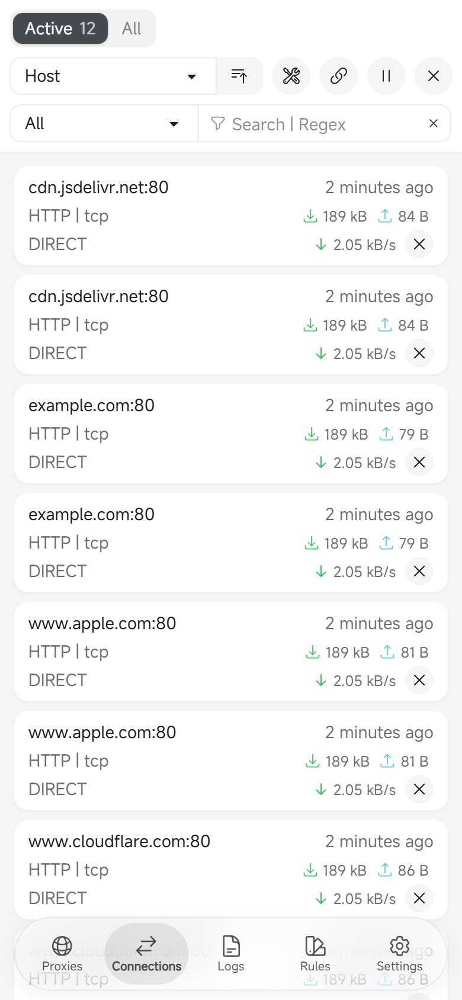
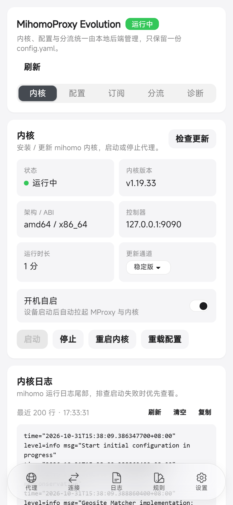
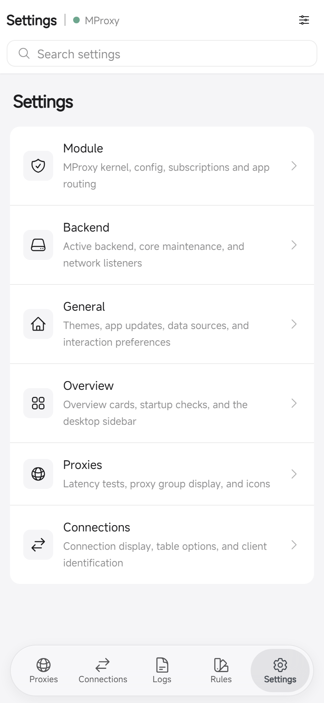

<div align="center">

# MihomoProxy Evolution

**A KernelSU / Magisk network proxy module built on mihomo and zashboard — everything managed from the WebUI, with one config file**

[](https://github.com/f1owkang/MProxyEvolution/releases)
[](#installation)
[](https://go.dev)
[](https://nodejs.org)
[](LICENSE)

English | [简体中文](README.md)

[Features](#features) | [Screenshots](#screenshots) | [Installation](#installation) | [How it works](#how-it-works) | [FAQ](#faq) | [Compatibility](#compatibility) | [Known limitations](#known-limitations) | [Build from source](#build-from-source) | [Repository layout](#repository-layout) | [Upstream sync](#upstream-sync) | [Disclaimer](#disclaimer) | [License](#license)

</div>

---

## Features

- **One config file**: `/data/adb/mproxy/config.yaml` is both the standard mihomo config and the single source of module settings (the `x-mproxy:` section, which mihomo ignores). Port, mode, TUN and app-split changes made in the panel are written back to the same file and survive reboots.
- **Everything in the WebUI**: reuses zashboard's Overview, Proxies, Rules, Connections and Logs pages, and adds a "Settings → Module" section for kernel install/update, start/stop, YAML editing and validation, subscription import, per-app routing, auto-start and diagnostics.
- **Same-origin access, no CORS**: the Go backend embeds the panel assets and listens only on `127.0.0.1:9091`; `/api/mihomo/*` reverse-proxies the mihomo controller (HTTP / SSE / WebSocket), so the panel never talks to the controller port directly and there is no mixed-content issue.
- **TUN transparent proxy**: TUN + fake-ip DNS enabled by default, with allow-list / deny-list per-app routing; rules, DNS, ports and subscriptions remain fully editable.
- **Safe config writes**: when the kernel is installed, every save is validated with `mihomo -t`, written to a temp file and atomically renamed, keeping a single backup at `config.yaml.bak`; a failed validation never overwrites the previous config.
- **Four architectures**: arm64-v8a / armeabi-v7a / x86 / x86_64. The module zip bundles all four backends and kernels; the installer keeps only the device's architecture.
- **Reproducible upstream**: mihomo is pinned to a release tag as a git submodule; zashboard uses a fork on the `panel` branch with `panel.lock` pinning the exact build commit, and CI checks for upstream updates and opens sync PRs daily.

## Screenshots

The WebUI at a glance (Overview / Proxies / Rules / Connections / MihomoProxy Evolution module / Settings). The nodes, traffic, rules and logs shown are **fabricated demo data**, used only to illustrate the UI — they do not represent any real device, network or measured result. The MihomoProxy Evolution module console is currently Simplified Chinese only, so its preview uses the Chinese screenshot.

<div align="center">

| Overview | Proxies | Rules |
| :---: | :---: | :---: |
| <a href=".github/images/overview-en.png"></a> | <a href=".github/images/proxies-en.png"></a> | <a href=".github/images/rules-en.png"></a> |

| Connections | MihomoProxy Evolution module | Settings |
| :---: | :---: | :---: |
| <a href=".github/images/connections-en.png"></a> | <a href=".github/images/mproxy-zh.png"></a> | <a href=".github/images/settings-en.png"></a> |

</div>

## Installation

Requires **KernelSU / KernelSU Next (recommended) or Magisk 26+**, Android 8.0+, and one of arm64-v8a / armeabi-v7a / x86 / x86_64. Download the module from [Releases](https://github.com/f1owkang/MProxyEvolution/releases), verify it and flash. Every release ships a **universal** package (four architectures, used by in-app auto-update) plus four **per-ABI packages**:

| Asset | Description |
| :-- | :-- |
| `MProxyEvolution-<versionCode>-<version>.zip` | **universal** package with four backends and mihomo kernels (arm64-v8a / armeabi-v7a / x86 / x86_64), for in-app auto-update and when the ABI is unknown; about 130 MB |
| `MProxyEvolution-<versionCode>-<version>-arm64-v8a.zip` | per-ABI package: arm64-v8a (most phones) |
| `MProxyEvolution-<versionCode>-<version>-armeabi-v7a.zip` | per-ABI package: armeabi-v7a (older 32-bit ARM phones) |
| `MProxyEvolution-<versionCode>-<version>-x86.zip` | per-ABI package: x86 (emulators / TV boxes) |
| `MProxyEvolution-<versionCode>-<version>-x86_64.zip` | per-ABI package: x86_64 (emulators / TV boxes) |

Every zip has a matching `.sha256`. Per-ABI packages contain only that ABI's backend and kernel (about 20-35 MB each), so pick the one matching your device.

> Which one: check the device ABI with `getprop ro.product.cpu.abi` and download the matching per-ABI package (recommended for phones, smaller download). arm64-v8a / armeabi-v7a phones use their own package; x86 / x86_64 (emulators, TV boxes) also pick by ABI, or use universal. If a non-matching per-ABI package is flashed, the installer tells you to download the right ABI package or use universal. In-app auto-update always uses universal.

```bash
# Show the device ABI (root shell; `adb shell` works too)
getprop ro.product.cpu.abi

# Verify (use the line matching the package you downloaded)
sha256sum -c MProxyEvolution-1-0.1.0.zip.sha256
sha256sum -c MProxyEvolution-1-0.1.0-arm64-v8a.zip.sha256
sha256sum -c MProxyEvolution-1-0.1.0-armeabi-v7a.zip.sha256
sha256sum -c MProxyEvolution-1-0.1.0-x86.zip.sha256
sha256sum -c MProxyEvolution-1-0.1.0-x86_64.zip.sha256
```

1. KernelSU / KernelSU Next: choose "Modules → Install" in the manager and pick the zip. **Reboot** after installation, then tap the module's "Open" button to enter the console.
2. Magisk: after flashing and rebooting, run `su -c /data/adb/mproxy/bin/mproxy boot` in a root shell and open the printed URL containing the token (Magisk has no built-in WebUI entry).
3. The first launch walks you through installing/updating the kernel and importing nodes or subscriptions; an existing `config.yaml` is never overwritten during module upgrades.
4. The installer asks you to pick a language and confirm with the volume keys; with no key pressed for 30 seconds it continues automatically, and Volume- cancels. For unattended/scripted installs set `MPROXY_HEADLESS=1` to skip the key prompts (e.g. `MPROXY_HEADLESS=1 ksud module install <zip>`).

See the [FAQ](#faq) below for installation details, uninstalling and troubleshooting.

## How it works

mihomo does the proxying, zashboard provides the UI, and a Go backend ties them together as a local same-origin service:

```text
KernelSU / Magisk WebView
  └─ module/webroot/index.html (bootstrap)
      └─ mproxy boot → http://127.0.0.1:9091/?token=...#/settings?section=moduleSettings
          └─ Go backend (127.0.0.1:9091, embeds zashboard)
              ├─ /api/mihomo/*   same-origin reverse proxy to the mihomo controller (HTTP / SSE / WS)
              ├─ /api/config     read / validate / import the single config.yaml
              ├─ /api/core/*     kernel install, start/stop, update
              └─ /api/mproxy/*   structured API for the MProxyEvolution pages
                  └─ mihomo -d /data/adb/mproxy -f config.yaml
```

- **Single config**: when `config.yaml` is missing, the backend generates a default template (random `secret`, TUN enabled, fake-ip DNS, private ranges direct, `MATCH,PROXY`). Panel changes go through `PATCH /api/mihomo/configs`, which merges them into the YAML before forwarding, so settings survive kernel restarts.
- **Same-origin proxy**: before the app starts, `mproxy-boot.js` injects the API base `/api/mihomo` and the token; the backend adds mihomo's `Authorization: Bearer` header and intercepts `PATCH/PUT /configs` and `restart` to persist changes.
- **Local-only listening**: the backend is fixed to `127.0.0.1:9091` and `/api/*` requires a random token (`state/token`, mode 0600). The mihomo controller defaults to `127.0.0.1:9090` and is not exposed to the LAN.
- **Four-architecture builds**: mihomo is cross-compiled as a static binary with `CGO_ENABLED=0 GOOS=linux` and `with_gvisor` (arm64 / armv7 / 386 / amd64); `customize.sh` keeps only the ABI reported by `ro.product.cpu.abi`, `post-fs-data.sh` prepares `/dev/net/tun`, and `service.sh` starts the backend after `sys.boot_completed`.

## FAQ

<details>
<summary>The WebUI is stuck on "Starting…"</summary>

Check that `/data/adb/mproxy/bin/mproxy` exists and is executable, run `/data/adb/mproxy/bin/mproxy boot` to see the output, and make sure port 9091 is free. Logs live in `/data/adb/mproxy/logs/` (`backend.log`, `core.log`, `service.log`).
</details>

<details>
<summary>No nodes on first launch, or no internet access?</summary>

The default config is direct mode. Open MihomoProxy Evolution → Subscription and import your Clash subscription (URL, file, or paste a full config; merge or replace), then make sure the kernel is running under "Kernel" and pick a node under "Proxies".
</details>

<details>
<summary>How do I update the kernel, panel and module?</summary>

Kernel: MihomoProxy Evolution → Kernel → Check for updates (stable / alpha; set `x-mproxy.ghproxy` to a mirror if downloads are slow). Panel and module: flash the new zip directly — `config.yaml` and subscriptions are preserved.
</details>

<details>
<summary>Do upgrades lose my config? Does uninstalling delete my data?</summary>

No. The installer never overwrites an existing `/data/adb/mproxy/config.yaml`; uninstalling only stops processes and removes the module directory, while the data directory `/data/adb/mproxy` is kept. Delete it manually if you want a full clean-up.
</details>

<details>
<summary>Which devices and architectures are supported?</summary>

Android 8.0+, KernelSU / KernelSU Next / Magisk 26+, and arm64-v8a / armeabi-v7a / x86 / x86_64. TUN mode needs kernel support for `/dev/net/tun` (missing on some stock kernels).
</details>

## Compatibility

| Environment | Status | Notes |
| :-- | :-- | :-- |
| KernelSU / KernelSU Next | ✅ Supported (recommended) | Built-in WebUI entry; reboot, then tap "Open" |
| Magisk 26+ | ✅ Supported | No built-in WebUI; after reboot run `su -c /data/adb/mproxy/bin/mproxy boot` |
| APatch | ⚠️ Best-effort | Magisk module format works; the installer detects `/data/adb/apd` and prints a note; not covered by CI or device regression |
| Android 8.0+, arm64-v8a / armeabi-v7a / x86 / x86_64 | ✅ Supported | The kernel must provide `/dev/net/tun` (missing on some stock kernels) |

- The module must be installed by a **Magisk / KernelSU / KernelSU Next / APatch manager** (or an equivalent module installer entry). When `BOOTMODE=false/0` is detected the installer refuses to continue, so it cannot write the module directory from a non-module environment.
- Scripted installs (e.g. `ksud module install`) can set `MPROXY_HEADLESS=1` to skip the volume-key selection and install automatically.
- APatch support is best-effort: the scripts run as a Magisk-format module, but there is no full device regression yet. When reporting issues, attach the panel's Settings → Diagnostics export and the `/data/adb/mproxy/logs/` logs.

## Known limitations

- **TUN only**: `proxy-mode` accepts only `tun` and `mixed`; v0.1 does not provide tproxy / redirect. Transparent proxying always goes through TUN.
- **Hotspot / USB tethering downstream clients are not guaranteed**: mihomo's `auto-route` covers local-device traffic; whether tethered clients are proxied depends on the ROM and network stack and is not guaranteed.
- **Private DNS (DoT)**: while TUN is active the module saves and turns off the system Private DNS mode (`private_dns_mode`), and restores the previous value on stop (the backend restores it on a best-effort basis after abnormal exits), so DoT cannot bypass fake-ip DNS. If a forced reboot leaves it disabled, re-enable it in Settings → Network & internet → Private DNS.
- **Other VPNs**: running another VPN at the same time (including the system VPN) may fight over routes; keep only one active. Dual-SIM, TV boxes and hotspot sharing should be validated on the real device.
- **Manager freezing / battery savers**: the kernel process runs outside the manager's cgroup, so switching the manager to the background or letting it be reaped does not stop proxying. Aggressive ROM battery savers or background freezers may still kill it; disable battery optimisation for the manager and MihomoProxy Evolution. Use `mproxy status` and `/data/adb/mproxy/logs/` when troubleshooting.
- **Log locations**: `/data/adb/mproxy/logs/` (`backend.log`, `core.log`, `service.log`); the panel's Settings → Diagnostics exports redacted diagnostics. `service.log` is truncated to the last 2000 lines once it exceeds 1 MiB.
- **Package size and KernelSU Modules**: the universal (four-architecture) zip is about 130 MB, above KernelSU Modules' 100 MB limit, so it ships only through GitHub Releases (and is the in-app auto-update target); the four per-ABI packages (arm64-v8a / armeabi-v7a / x86 / x86_64, about 20-35 MB each) are all below 100 MB, and the **arm64-v8a** package is the one submitted to KernelSU Modules (covers the vast majority of phones).

## Build from source

You need Git, Go 1.26+, Node.js 22+, pnpm 11+, `zip` and `sha256sum`.

```bash
# 1. Fetch the pinned upstream sources
git submodule update --init --recursive

# 2. Build: panel → Go backend (4 arches) → mihomo kernel (4 arches) → package
bash scripts/build.sh

# Windows (PowerShell 7)
pwsh -File scripts/build.ps1

# Output: dist/MProxyEvolution-1-0.1.0.zip and .sha256
```

| Purpose | `build.sh` | `build.ps1` |
| --- | --- | --- |
| Set version | `--version 0.2.0` | `-Version 0.2.0` |
| Skip the panel build | `--skip-panel` | `-SkipPanel` |
| Skip the backend build | `--skip-backend` | `-SkipBackend` |
| Skip the kernel build | `--skip-core` | `-SkipCore` |
| Assemble without zipping | `--skip-zip` | `-SkipZip` |
| Clean before building | `--clean` | `-Clean` |

For panel development you do not need a full package every time:

```bash
# Check out the zashboard fork commit pinned by panel.lock into build/panel
bash scripts/dev-panel.sh --prepare

# Check out + install dependencies + build the panel (output: build/panel/web/dist)
bash scripts/dev-panel.sh --all

# Windows equivalent: scripts/dev-panel.ps1 (-Prepare / -Install / -Build / -All)

# Run the backend locally (MPROXY_DEV=1 disables /api auth; data dir defaults to ./.dev-data)
cd backend && MPROXY_DEV=1 go run ./cmd/mproxy serve
```

## Repository layout

| Path | Contents |
| --- | --- |
| `upstream/mihomo/` | git submodule: mihomo kernel source, pinned to a release tag (currently v1.19.33) |
| `panel` branch / `panel.lock` | zashboard fork: full upstream history plus MProxyEvolution commits on the `panel` branch; `panel.lock` pins the exact build commit checked out to `build/panel` |
| `backend/` | Go 1.26 backend: same-origin API, config and kernel management, embedded panel assets |
| `module/` | KernelSU / Magisk module scripts, `module.prop` and the bootstrap page in `webroot/` |
| `scripts/` | `dev-panel.*` checks out the pinned fork commit; `build.*` builds and packages |
| `.github/` | CI / Release / sync-upstream workflows, issue templates, screenshots |
| `module.json`, `module.yaml` | Module metadata (module repository / MMRL and update info) |
| `update.json` | Module update manifest referenced by `updateJson` in `module.prop` |
| `THIRD_PARTY_NOTICES.txt` | Third-party copyright and license notices |
| `LICENSE` | Project license (GPL-3.0) |

## Upstream sync

The panel is maintained as a **fork + git merge**: the full zashboard upstream history lives on the `panel` branch, MProxyEvolution changes are ordinary commits on it, and `panel.lock` pins the exact build commit that `scripts/dev-panel.sh` checks out into `build/panel`. The build no longer reads an overlay or applies a text patch.

`upstream/mihomo` is a git submodule pinned to a release tag — never to a branch HEAD. `.github/workflows/sync-upstream.yml` checks the latest release of both upstreams daily: mihomo updates the submodule, while zashboard's release tag is merged into the `panel` branch and a `chore/sync-panel-<tag>` PR is opened that only updates `panel.lock` and the mihomo submodule. That PR is created with the workflow token, so it does not trigger CI automatically; verify locally or dispatch the workflow manually before merging. Pushing a `v*` tag makes `release.yml` build `dist/MProxyEvolution-<versionCode>-<version>.zip` plus `.sha256` and create the GitHub Release.

Sync failures fail the workflow and need manual handling; the release flow is defined by `.github/workflows/release.yml`.

## Disclaimer

- Flashing this module modifies the system module directory and network configuration and **may affect boot and connectivity**. Make sure you understand how to flash, roll back and recover with KernelSU / Magisk; proceed at your own risk.
- This project only provides proxy capability and **does not provide any nodes, subscriptions or proxy service**. Using a proxy must comply with local laws and regulations, network terms of service and carrier rules; you are responsible for your own use.
- The panel and kernel listen on loopback only; configs, logs, subscriptions and the token stay in `/data/adb/mproxy` and are never uploaded anywhere.
- The software is provided "as is", without warranty of any kind, express or implied.

## License

This project is licensed under [GPL-3.0](LICENSE). The panel comes from [zashboard](https://github.com/Zephyruso/zashboard) (MIT) and the kernel from [mihomo](https://github.com/MetaCubeX/mihomo) (GPL-3.0); see [THIRD_PARTY_NOTICES.txt](THIRD_PARTY_NOTICES.txt) for the complete third-party notices. When distributing a module package that contains the mihomo binary, the corresponding source is available through the `upstream/mihomo` submodule and the build scripts.
